# Current WESA Harness Flow

**Version**: 0.6.0  
**Implemented through**: P6 orchestration, provider abstraction and trusted plugin management  
**Execution state**: Ollama live; Vertex Gemini configured through ADC; generic workflows and sandbox execution live

**Editable version**: [current-flow.excalidraw](current-flow.excalidraw) — import directly into Excalidraw for full-screen zoom, pan and editing.

## System flow

```mermaid
flowchart LR
    G["Greg"] --> D["Avalonia desktop shell"]

    subgraph CONTROL[".NET 10 control plane"]
        API["REST API<br/>thin controllers"]
        CQRS["CQRS<br/>commands · validators · handlers"]
        SIGN["Task signer<br/>canonical JSON + HMAC-SHA256"]
        OUTBOX["Transactional outbox<br/>event wake + 1s–10m fallback"]
        SIGNALR["SignalR event stream"]
    end

    D -->|"authenticated task / pipeline / attachment request"| API
    API --> CQRS
    CQRS --> SIGN

    subgraph ENGINE["Python Secure Engine — trusted kernel"]
        RPC["JSON-RPC/JSONL<br/>supervised stdio"]
        AUTH["Verify issuer + signature<br/>10-minute timestamp window"]
        REPLAY["Durable nonce store<br/>reject replay"]
        CAP["Agent capability manifest<br/>agent + task + provider policy"]
        PATH["Canonical path policy<br/>workspace + protected files"]
        INPUT["Input firewall<br/>redaction + untrusted-source tags"]
        TOOLS["Tool Broker<br/>tool + operation + scope"]
        MEM["Memory adapter<br/>scope-before-rank + promotion gate"]
        SHADOW["Signed task authorized<br/>execution enabled"]
        DENY["Reject<br/>no state change"]
    end

    SIGN -->|"signed TaskEnvelopeV2"| RPC
    RPC --> AUTH --> REPLAY --> CAP --> PATH --> INPUT
    INPUT --> TOOLS --> MEM --> SHADOW
    AUTH -->|"invalid / stale"| DENY
    REPLAY -->|"nonce reused"| DENY
    CAP -->|"agent or task denied"| DENY
    PATH -->|"escape / protected target"| DENY

    subgraph NEON["Unified WESA Neon database"]
        HARNESS["harness schema<br/>workspaces · sessions · tasks<br/>trajectory · approvals · artifacts · outbox"]
        MEMORY["memory schema<br/>policies · preferences · facts<br/>episodes · traces"]
        PUBLIC["public schema<br/>EF migration history"]
    end

    CQRS -->|"queued task transaction"| HARNESS
    HARNESS --> OUTBOX --> SIGNALR --> D

    subgraph ARTIFACTS["Live artifact safety path"]
        PROVIDER["Selected model-provider plugin"]
        OLLAMA["Ollama<br/>local discovery · retries · circuit breaker"]
        VERTEX["Vertex Gemini<br/>ADC · explicit paid selection"]
        ART["Generated artifact"]
        GATE["Validation Gate<br/>size · encoding · syntax · secrets · risky code"]
        ACCEPT["Accept"]
        REVIEW["Review queue"]
        PROPOSAL["Protected-file patch proposal"]
        QUARANTINE["Quarantine"]
        PROVIDER --> OLLAMA --> ART --> GATE
        PROVIDER --> VERTEX --> ART
        GATE --> ACCEPT
        GATE --> REVIEW
        GATE --> PROPOSAL
    GATE --> QUARANTINE
    SHADOW -->|"invoke allowed provider/model"| PROVIDER
    ACCEPT -->|"terminal transaction"| CQRS
    REVIEW -->|"terminal transaction"| CQRS
    PROPOSAL -->|"terminal transaction"| CQRS
    QUARANTINE -->|"terminal transaction"| CQRS
    end

    PIPELINE["Versioned workflow engine<br/>DAG · conditions · retries/repeats<br/>approval · sandbox · schedules"]
    CQRS --> PIPELINE
    PIPELINE -->|"separate signed stage tasks"| SIGN
    ACCEPT -->|"post-accept episode only"| MEM

    subgraph EXECUTION["P5 isolated execution — live on local k3d validation cluster"]
        APPROVE["Greg-only sandbox request"]
        SBX["Allowlisted K3s Job<br/>non-root · RO source/rootfs<br/>no network · limits · deadline"]
        RESULT["stdout/stderr result artifact"]
        APPROVE --> SBX --> RESULT --> GATE
        ACCEPT -. "accepted Python source" .-> APPROVE
    end

    LEGACY["Existing agent-ecosystem<br/>still operational"]
    LEGACY -. "separate until final cutover" .-> CONTROL

    classDef user fill:#e8f1ff,stroke:#2563eb,color:#0f172a,stroke-width:2px
    classDef control fill:#ecfdf5,stroke:#059669,color:#052e2b
    classDef kernel fill:#fff7ed,stroke:#ea580c,color:#431407,stroke-width:2px
    classDef data fill:#f5f3ff,stroke:#7c3aed,color:#2e1065
    classDef blocked fill:#fef2f2,stroke:#dc2626,color:#450a0a
    classDef future fill:#f8fafc,stroke:#64748b,color:#334155,stroke-dasharray: 5 5

    class G,D user
    class API,CQRS,SIGN,OUTBOX,SIGNALR control
    class RPC,AUTH,REPLAY,CAP,PATH,INPUT,TOOLS,MEM,SHADOW kernel
    class HARNESS,MEMORY,PUBLIC data
    class DENY,QUARANTINE blocked
    class PROVIDER,OLLAMA,VERTEX,ART,GATE,ACCEPT,REVIEW,PROPOSAL control
    class APPROVE,SBX,RESULT kernel
    class LEGACY future
```

## What happens today

1. The desktop authenticates locally, loads agents, provider policy and models from Ollama or configured Vertex Gemini.
2. A submitted task is committed as queued and returned immediately.
3. The background worker signs provider/model selection and sends the envelope to Python.
4. Python verifies issuer, signature, timestamp, nonce, reduced issuer rights, profile, manifest and output path.
5. Scoped memory is retrieved before ranking and injected within a token budget.
6. Optional text attachments pass the Tool Broker, hash/media checks, redaction and untrusted-source wrapping.
7. The selected allowed provider runs the model. Ollama is default; Vertex Gemini uses ADC and requires explicit selection.
8. Model output passes deterministic Artifact Gate checks.
9. Accepted content is written atomically and only accepted work creates memory episodes; other outcomes route to review, proposal or quarantine.
10. Neon stores task, pipeline, command-audit, trajectory, outbox and artifact metadata.
11. Versioned workflow definitions run dependency-based stages, parallel-ready waves, conditions, bounded retries/repeats, approvals and sandbox stages. Schedules are disabled by default.
12. The bottom Gate Inspector renders the persisted execution trace and exact reasons.
13. Greg may request an allowlisted sandbox profile only for a Gate-accepted Python artifact; no local execution fallback exists.
14. Metrics expose queue age/depth, throughput/failures, gate outcomes, outbox/pipeline/sandbox state, plugin health, memory promotions and audit validity.

## Validation Gate outcomes

| Outcome | Meaning |
|---|---|
| Accept | Artifact passed deterministic checks. |
| Review | Human review required; common examples are unresolved imports or redacted credentials. |
| Proposal | A protected-file change is stored only as a patch proposal. |
| Quarantine | Unsafe path, invalid syntax, dynamic execution or other high-risk content. |

## Current boundaries

- The Secure Kernel is not a plugin.
- Trusted plugin kinds now include model, embedding, retrieval, document extraction, tools, sandbox, scheduler and workflow extensions. Only built-ins load in v0.6.
- The .NET UI/API cannot bypass Python authorization.
- Workers cannot write directly to Neon, the filesystem, memory or protected configuration.
- Read tools are granted by exact tool, operation and path scope. Mutation tools remain disabled.
- API, pipeline and headless issuers have separate keys; headless is limited to low-risk task types and `staging/headless/**`.
- Text attachments are live. Binary/PDF/image extraction remains on the legacy system until specialized plugins are migrated.
- Sandbox Jobs/manifests are live on the local k3d validation cluster. Network-policy drills remain mandatory for every new environment.
- Mobile monitor token is read-only; task/pipeline/sandbox/workspace mutations return HTTP 403.
- `agent-ecosystem/` and `wesa-harness/` remain separate systems until Greg approves final cutover.
- The `memory` and `harness` schemas share one WESA Neon project but retain separate ownership and migration boundaries.

## Next gate

P7: migrate the existing Wolfmed PDF extraction/test-generation workflow as the first production-use Harness pipeline and benchmark Ollama quality.
